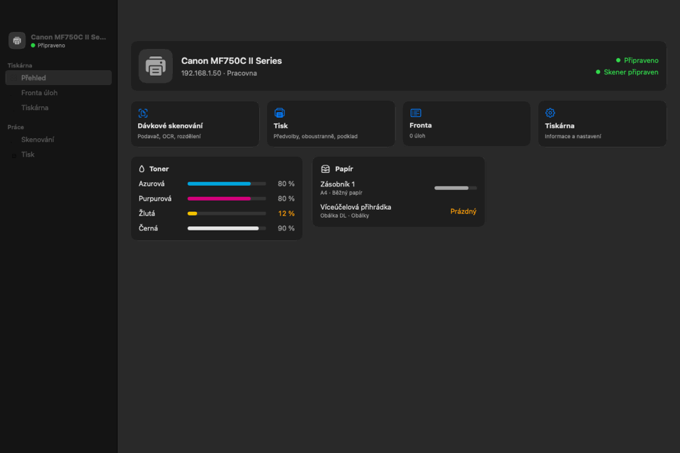

# Skener (česky)

Skenování, tisk a přehled o síťové tiskárně z Macu, bez ovladačů a aplikací výrobce. Postaveno pro Canon
i-SENSYS / imageCLASS, PIXMA a MAXIFY. Funguje s každou tiskárnou, která umí **IPP** (AirPrint) a **eSCL** (AirScan).
Seznam modelů je v [anglickém README](README.md#supported-printers).

<p align="center"></p>

## Co umí

- **Přehled**: stav tiskárny, upozornění (papír, zaseknutí, toner), hladiny tonerů, papír v zásobnících a rychlé akce
- **Dávkové skenování**
  - předvolby, podavač i sklo, oboustranně
  - dělení dávky podle prázdného listu nebo po N stranách
  - vyřazení prázdných stran, které jdou vrátit
  - ruční úpravy dokumentů a stránek
  - PDF s prohledávatelným textem
- **Tisk**
  - náhled toho, co se vytiskne
  - předvolby: Standardní, Úsporně, Oboustranně, Fotky, Obálka DL a vlastní
  - kopie, rozsah stránek, N stran na list, formát, **zásobník**, orientace, měřítko, oboustranně, barva, kvalita
  - **hlavičkový papír** (podklad z PDF)
- **Fronta úloh** s rušením, **Najít tiskárnu** (pípne a blikne) a **webové nastavení tiskárny** přímo v aplikaci
- **Ikona v liště** se stavem a tonery, **protokol komunikace** (⌘L)

## Instalace

Hotovou aplikaci stáhněte z [Releases](https://github.com/micfold/mac-scanner/releases). Poprvé ji otevřete pravým
tlačítkem → **Otevřít**.

Nebo ji sestavte sami (Xcode nebo Command Line Tools):

```bash
git clone https://github.com/micfold/mac-scanner.git ~/Developer/mac-scanner
cd ~/Developer/mac-scanner
make app && open build/Skener.app
```

Při prvním spuštění povolte **přístup k místní síti** (Nastavení systému → Soukromí a zabezpečení → Místní síť).

## Když něco nejde

| Hláška | Co s tím |
|---|---|
| Tiskárna ukazuje „Skenování…“, ale nic nepřijde | Otevřete protokol (⌘L) a pošlete ho v issue |
| HTTP 403 / 401 | Na tiskárně zapněte AirPrint / IPP skenování |
| „Tiskárna nepřijímá PDF přímo“ | V Nastavení (⌘,) vyberte frontu macOS, tisk pak půjde přes systémový ovladač |
| Zbytečně vyřazuje stránky | Posuňte citlivost doleva, vyřazené stránky vrátíte tlačítkem *Vrátit* |
