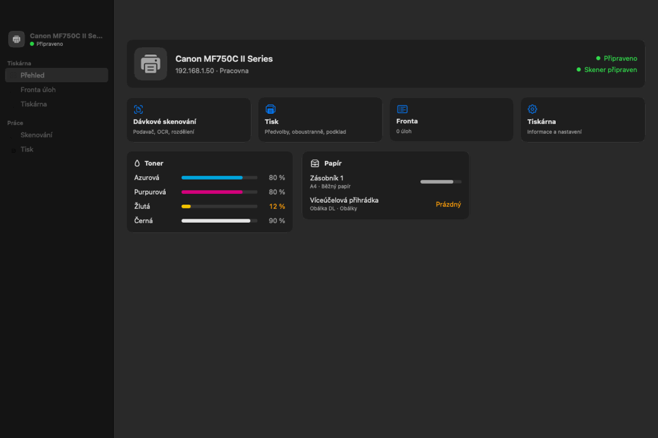

<p align="center"></p>

<h1 align="center">Skener</h1>

<p align="center">
Scan, print and keep an eye on your network printer from your Mac. No vendor drivers, no vendor apps.<br>
Built for Canon i-SENSYS / imageCLASS, PIXMA and MAXIFY. It works with any printer that speaks <b>IPP</b> and <b>eSCL (AirScan)</b>.
</p>

<p align="center">
<a href="https://github.com/micfold/mac-scanner/actions/workflows/ci.yml"></a>


<a href="LICENSE"></a>
</p>

<p align="center"></p>

> 🇨🇿 The interface is in **Czech** for now; English is on the roadmap. Czech instructions: [README.cs.md](README.cs.md).

## Features

**Overview** shows the printer state, alerts (paper out, jam, low toner), toner levels, paper per tray and quick actions.

**Batch scanning**
- Presets (invoices, contracts, receipts, photos …), each with source, colour, resolution, splitting, naming and folder
- Feeder and flatbed, duplex, live thumbnails while pages come in
- Splits a pile into documents: by blank separator sheet, every *N* pages, one per page, or all in one.
  In duplex, only a sheet blank on **both** sides splits, so blank backs are just dropped.
- Blank-page removal with adjustable sensitivity. Removed pages stay visible and can be restored.
- Rename, merge, split, rotate and delete pages; append more pages to the last document
- Searchable PDFs (on-device OCR). The scanner's JPEGs are embedded unchanged.

**Printing**
- Drop PDFs or images; see a live preview of exactly what will print
- One-click presets: Standard, Economy (B&W, duplex, 2 per sheet), Duplex, Photos, DL envelope, or your own
- Copies, page ranges, pages per sheet, paper size, **tray**, orientation, scaling, duplex (long/short edge), colour, quality.
  Only the options your printer reports are offered.
- **Letterhead**: print every page over a PDF background (logo, address, footer)
- Sent straight to the printer over IPP; falls back to the macOS print queue if the printer can't take PDF

**More**
- Job queue with cancel
- *Find printer* (makes it beep/flash) and the printer's web settings inside the app
- Menu bar status with toner levels and quick actions
- Bonjour discovery, communication log (⌘L) for troubleshooting

## Supported printers

Any network printer with **IPP (AirPrint) printing** and **eSCL (AirScan) scanning**. For Canon that means most
network models since about 2017:

| Family | Examples reported to work | |
|---|---|---|
| i-SENSYS / imageCLASS MF | MF750C II (MF752Cdw/MF754Cdw), MF740 (MF743/745/746), MF640 (MF641/643/644), MF440, MF410, MF260, MF240 | **MF750C II tested by the author** |
| PIXMA | TS3100–TS3300, TS5000, TS6x00, TS9550, TR4520–TR8520, MG3600, MG5765 | scanning reported via eSCL |
| MAXIFY | MB5100, MB5400 | scanning reported via eSCL |
| Older PIXMA (MG5200/5300/5500, MX470, G3000, TR7500) | | ❌ WSD-only scanning |
| USB-only (CanoScan LiDE …) | | ❌ network only |

Scanner compatibility data comes from community testing ([sane-airscan](https://github.com/alexpevzner/sane-airscan),
[sane-escl](https://manpages.debian.org/bullseye/libsane-common/sane-escl.5.en.html)), not from Canon. Printers from
other brands with IPP/eSCL (HP, Brother, Epson, Kyocera …) should work too.

**Check yours in 30 seconds:**

```bash
dns-sd -B _uscan._tcp        # scanners on the network (Ctrl-C to stop)
dns-sd -B _ipp._tcp          # printers on the network
```

Some Canon models ship with network scanning off: enable **AirPrint** / **IPP scanning** on the printer panel or in its
web interface (*Settings/Registration → Network Settings*).

## Install

Requires **macOS 14+**.

**Download:** grab `Skener-vX.zip` from [Releases](https://github.com/micfold/mac-scanner/releases) (or the latest
[CI build](https://github.com/micfold/mac-scanner/actions/workflows/ci.yml)). The app is ad-hoc signed: right-click →
**Open** the first time.

**Build from source** (Xcode or Command Line Tools):

```bash
git clone https://github.com/micfold/mac-scanner.git ~/Developer/mac-scanner
cd ~/Developer/mac-scanner
make app && open build/Skener.app
```

On first launch allow **Local Network** access (System Settings → Privacy & Security → Local Network).

## Command-line tool

```bash
swift run skener-cli info     <ip>                 # state, supplies, trays, print options
swift run skener-cli print    <ip> file.pdf --duplex --mono --pages 1-3 --copies 2
swift run skener-cli jobs     <ip>
swift run skener-cli identify <ip>
swift run skener-cli scan     <ip> --out ~/Desktop/test   # feeder, duplex → JPEGs
swift run skener-cli caps     <ip>
# add -v to any command to log every request
```

## Troubleshooting

| Symptom | What to do |
|---|---|
| Printer shows "Scanning…" but nothing arrives | Open the log (⌘L) or run `skener-cli scan <ip> -v` and attach it to an issue |
| HTTP 401 / 403 | Network scanning/printing is disabled on the printer: enable AirPrint / IPP |
| "Printer does not accept PDF" | Pick the macOS queue in Settings (⌘,): printing then goes through the system driver |
| Pages wrongly dropped as blank | Lower the sensitivity; restore pages with *Vrátit* |

## Development

```bash
make test        # Swift Testing; PrinterKit also runs on Linux
make lint        # swift-format, enforced in CI
make snapshots   # renders every screen + demo.gif from sample data
```

The architecture (modular SwiftPM, `@Observable` feature models, protocol services, Swift 6 concurrency) is described
in [docs/ARCHITECTURE.md](docs/ARCHITECTURE.md). See [CONTRIBUTING.md](CONTRIBUTING.md) for reporting printers and opening PRs.

## License

[MIT](LICENSE). Not affiliated with Canon Inc. "Canon", "i-SENSYS", "imageCLASS", "PIXMA" and "MAXIFY" are trademarks of
Canon Inc.
