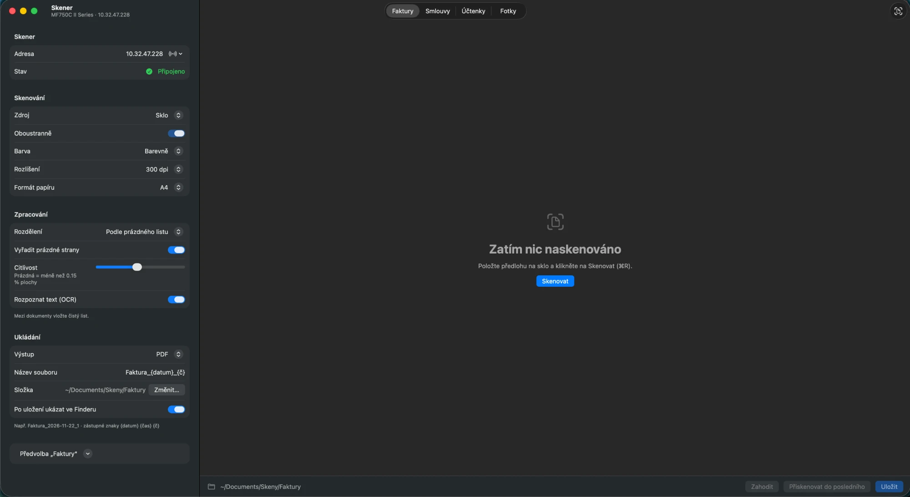

<p align="center"></p>

<h1 align="center">Skener</h1>

<p align="center">
Batch document scanning for macOS over the network: no Canon drivers, no Canon apps.<br>
Built for Canon i-SENSYS / imageCLASS and PIXMA printers. It works with any scanner that speaks <b>eSCL (AirScan / AirPrint scanning)</b>.
</p>

<p align="center"></p>

> 🇨🇿 The app's interface is currently in **Czech**. Czech instructions: [README.cs.md](README.cs.md).

## Why

Canon's macOS software for its office printers is clunky or missing. The printers already have a
standard network scanning protocol built in (eSCL, the same one AirPrint uses). Skener talks to it
directly and adds what you need for paperwork:

- **Presets** (Invoices, Contracts, Receipts, Photos, …): source, colour, resolution, splitting, naming and folder in one click
- **ADF and flatbed**, duplex, colour or greyscale, A4 / A5 / Letter / Legal
- **Live thumbnails** while pages come in
- **Automatic splitting of a batch** into separate documents: by blank separator sheet, every *N* pages, one per page, or all in one.
  In duplex mode only a sheet that is blank on **both** sides splits a document. Blank backs of single-sided pages are just dropped.
- **Blank-page removal** with adjustable sensitivity. Removed pages stay visible and can be restored with one click.
- **Manual fixes**: rename, merge with previous, split here, rotate, delete (right-click a thumbnail)
- **Append to last document** when the stack doesn't fit in the feeder, or for multi-page flatbed scans
- **Searchable PDFs** (OCR via Apple's Vision framework, Czech/Slovak/English/German where the system supports them). JPEG pages are embedded unchanged.
- **File naming** such as `Invoice_{datum}_{č}`. Numbers continue from the files already in the folder.
- **Bonjour discovery** of scanners on the network, or enter an IP address
- **Communication log** (⌘L, also written to `~/Library/Logs/Skener.log`) for troubleshooting

## Supported printers

Skener works with **any network scanner that supports eSCL** (also called *AirScan* or *AirPrint scanning*).
For Canon that means most network-connected models released since about 2017:

| Family | Examples reported to support eSCL scanning | Status |
|---|---|---|
| **i-SENSYS / imageCLASS MF** (laser MFPs) | MF750C II series (MF752Cdw / MF754Cdw), MF740 series (MF743Cdw, MF745Cdw, MF746Cx), MF640 series (MF641Cw, MF643Cdw, MF644Cdw), MF440 series, MF410 series, MF260 series, MF240 series | **MF750C II tested by the author**; others reported working with eSCL by the [sane-airscan](https://github.com/alexpevzner/sane-airscan) project |
| **PIXMA** (inkjet) | TS3100–TS3300, TS5000, TS6x00, TS9550, TR4520–TR8520, MG3600, MG5765 series | Reported working via eSCL ([sane-airscan](https://github.com/alexpevzner/sane-airscan-unstable), [sane-escl](https://manpages.debian.org/bullseye/libsane-common/sane-escl.5.en.html)) |
| **MAXIFY** | MB5100, MB5400 series | Reported working via eSCL |
| Older PIXMA | MG5200, MG5300, MG5500, MX470, G3000, TR7500 | ❌ Not supported. These only offer WSD scanning, not eSCL. |
| USB-only scanners | CanoScan LiDE … | ❌ Not supported. Skener is network-only. |

These lists are compiled from community testing, not from Canon, and they are not exhaustive. Many other models work too.
Non-Canon eSCL scanners (HP, Brother, Epson, Kyocera, Xerox, …) should also work, but they have not been tested.

### Check your printer in 30 seconds

1. Your Mac should see the scanner on the network. Run this in Terminal and stop it with Ctrl-C:
   ```bash
   dns-sd -B _uscan._tcp
   ```
   If your printer appears, it supports eSCL. Skener will also find it automatically.
2. Or ask the printer directly (after building, see below):
   ```bash
   swift run skener-cli caps 192.168.1.50
   ```
   It prints the model, the available sources (flatbed / feeder / duplex), colour modes and resolutions.

**Printer not responding?** Some Canon models ship with network scanning switched off. On the printer panel, or in the
printer's web interface (Remote UI) under *Settings/Registration → Network Settings*, enable **AirPrint** and
**IPP / network scanning**. The exact menu names vary by model.

## Install

Requirements: **macOS 14 Sonoma or newer**, and Xcode or only the Command Line Tools (`xcode-select --install`).

```bash
git clone https://github.com/micfold/skener.git ~/Developer/skener
cd ~/Developer/skener
./scripts/build-app.sh
open build/Skener.app
```

Optionally copy the app to Applications:

```bash
cp -R build/Skener.app /Applications/
```

On first launch macOS asks for **Local Network** access. Allow it, otherwise Skener cannot reach the printer
(*System Settings → Privacy & Security → Local Network → Skener*).

Prefer a ready-made build? Every push builds the app on GitHub Actions. Download `Skener.zip` from the
latest successful [workflow run](../../actions). The app is ad-hoc signed, so right-click it → **Open** the first time.

## Usage

1. Pick a preset at the top (Faktury = invoices, Smlouvy = contracts, Účtenky = receipts, Fotky = photos).
2. Load paper face-up in the feeder, or place it on the glass, and press **Skenovat** (⌘R).
3. Check the documents. Right-click a thumbnail to rotate, split or delete it.
4. Press **Uložit** (⌘S). The PDFs go to the preset's folder and Finder shows them.

Splitting a pile of invoices: put a blank sheet between them and use *Rozdělení → Podle prázdného listu* (split by blank sheet).

## Command-line tool

```bash
swift run skener-cli caps   <ip>        # what the scanner supports
swift run skener-cli status <ip>        # scanner, feeder and job state
swift run skener-cli scan   <ip> --out ~/Desktop/test   # ADF duplex scan to JPEGs
#   --sklo (flatbed)  --jednostranne (simplex)  --seda (greyscale)  --dpi 150  -v (log all HTTP)
```

## Troubleshooting

| Symptom | What to do |
|---|---|
| *Cannot connect* | Check the IP address (printer panel → network settings) and run `skener-cli caps <ip>`. |
| HTTP 401 / 403 | Network scanning is disabled or locked on the printer. Enable AirPrint / IPP scanning (see above). |
| Printer shows "Scanning…" but nothing arrives | Open the log (⌘L) or run `skener-cli scan <ip> -v` and attach the output to an issue. |
| Pages wrongly dropped as blank | Move *Citlivost* (sensitivity) to the left. Dropped pages can be restored with *Vrátit*. |

## How it works

```
Sources/ScanCore    eSCL client (capabilities, status, ScanJobs/NextDocument), batch splitting, naming. Foundation only, with unit tests.
Sources/Skener      SwiftUI app: presets, live batch, blank detection, PDF + invisible OCR text layer, Bonjour discovery.
Sources/skener-cli  Command-line tool for testing a scanner.
```

Pages are always requested as JPEG and the PDF is assembled locally. That makes blank detection, splitting
and OCR possible, and keeps the original JPEG data in the PDF without recompression.

```bash
swift test      # runs on macOS and Linux
```

## Roadmap

- English UI (localisation)
- Printing with templates and letterhead, printer status and toner levels in the menu bar
- Scan-to-Skener from the printer's own panel

Contributions and reports from other printer models are welcome. Please include `skener-cli caps <ip>` output.

## License

[MIT](LICENSE). Not affiliated with or endorsed by Canon Inc. "Canon", "i-SENSYS", "imageCLASS", "PIXMA" and "MAXIFY" are trademarks of Canon Inc.
